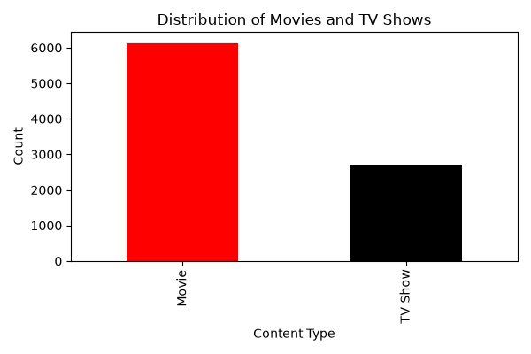
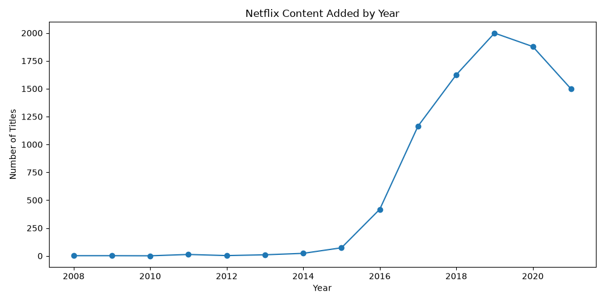
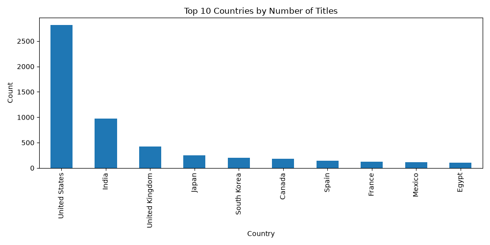
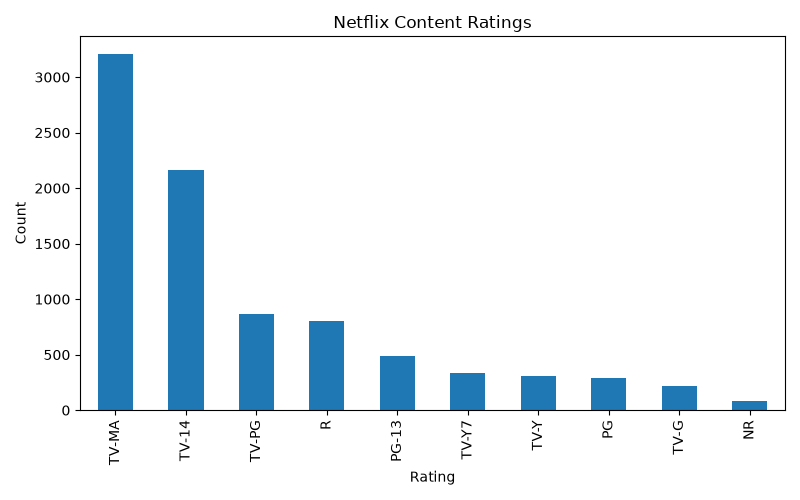

# Netflix Content Analysis

## Research Question

What trends can be observed in the composition, growth, geographic origin, and audience targeting of Netflix movies and TV shows?

## Project Overview

This project performs exploratory data analysis (EDA) on the Netflix Movies and TV Shows dataset to characterise how the platform's catalogue is structured. It examines four dimensions: the balance between movies and TV shows, the growth of content additions over time, the geographic concentration of production, and the distribution of maturity ratings.

The project demonstrates a complete, reproducible data science workflow: loading raw CSV data, inspecting and handling missing values, transforming date fields, aggregating categorical variables, producing four publication-ready visualisations, and translating those visuals into written findings.

## Dataset Source and Usage Permissions

| Item | Detail |
|---|---|
| Dataset | Netflix Movies and TV Shows |
| Platform | Kaggle |
| Original source | Flixable (public Netflix catalogue listing) |
| Licence | CC0: Public Domain — verify the *License* field on the Kaggle dataset page before reuse |
| Records | Approximately 8,800 titles |
| Snapshot | Mid-2021; the catalogue has changed substantially since |
| Content | show_id, type, title, director, cast, country, date_added, release_year, rating, duration, listed_in, description |

**Usage permission:** This dataset is publicly available and is used here strictly for educational and portfolio purposes. It contains no personal or identifying information about individuals, no credentials, and no restricted material.

**Note on redistribution:** The CSV is committed to this repository for reproducibility under the terms of its CC0 licence. If the licence on the source page differs, replace this file with a download script rather than committing the data directly.

## Methods and Tools Used

### Programming Language
- Python 3

### Libraries
- **pandas** — data loading, cleaning, type conversion, aggregation
- **matplotlib** — all four visualisations

### Techniques
- Data inspection (`shape`, `columns`, `isnull().sum()`)
- Date parsing and coercion (`pd.to_datetime` with `errors="coerce"`)
- Missing-value handling via `dropna()` prior to categorical counting
- Frequency analysis with `value_counts()`
- Exploratory data analysis (EDA) and data visualisation

### Environment
- Jupyter Notebook

## Visualizations

| # | File | Chart | What it shows |
|---|---|---|---|
| 1 | `visualization1.png` | Bar chart | Distribution of movies vs. TV shows |
| 2 | `visualization2.png` | Line chart | Number of titles added per year (2008–2021) |
| 3 | `visualization3.png` | Bar chart | Top 10 countries by number of titles |
| 4 | `visualization4.png` | Bar chart | Distribution of content maturity ratings |

## Key Findings

1. **The catalogue is film-dominated.** Movies account for roughly 6,100 titles against roughly 2,700 TV shows — about 70% of the library. Despite Netflix's reputation for original series, film remains the numerical backbone of the catalogue.

2. **Content growth peaked in 2019, not 2021.** Annual additions were negligible before 2014, accelerated sharply from 2015, climbed to around 1,100 (2017) and 1,600 (2018), and peaked at approximately 2,000 titles in 2019. The apparent decline in 2020–2021 is an artefact of the dataset snapshot being taken mid-2021 (see Limitation), not evidence of reduced production.

3. **Production is heavily US-centric with a long tail.** The United States contributes close to 2,800 titles — nearly three times India in second place (approximately 1,000). The United Kingdom follows at around 400, and every other country in the top ten falls below 300, indicating that non-US local production remains limited in absolute terms.

4. **The library targets mature audiences.** TV-MA (>3,000 titles) and TV-14 (~2,100) are by far the most common ratings, while family-friendly ratings (TV-Y, TV-Y7, TV-G) are marginal. Netflix's content mix is clearly skewed toward adult viewers rather than children's programming.

## Limitation

Country counts are derived from the raw `country` field without splitting co-production entries. A title listed as "United States, India" is therefore counted as a single distinct country string rather than being attributed to each country involved. The figures thus represent "country mentions" rather than exclusive country of origin, and titles with multiple production countries are undercounted per country. In addition, the dataset is a mid-2021 snapshot, so 2021 figures are incomplete and no conclusions about post-2021 growth should be drawn from this analysis.

## Project Status

Completed — all four planned analyses are finished and reproducible.

## Instructions for Running the Analysis

### 1. Clone the repository

### 2. Create and activate a virtual environment (recommended)

bash
python -m venv venv
source venv/bin/activate # macOS / Linux
venv\Scripts\activate # Windows

### 3. Install dependencies

bash
pip install -r requirements.txt

### 4. Run the notebook

bash
jupyter notebook Netflix_Content_Analysis.ipynb

Then run all cells in order (Kernel → Restart & Run All).

### Expected behaviour

- The notebook reads `netflix_titles.csv` from the repository root.
- It prints the dataset shape, column list, missing-value counts, and three summary tables (content type, top countries, top ratings).
- It regenerates `visualization1.png` through `visualization4.png` in the same directory, overwriting the committed copies. Output is identical to the images shown above.

### Troubleshooting

- **`FileNotFoundError` on `netflix_titles.csv`** — ensure your working directory is the repository root, not a subfolder.
- **Charts not displaying inline** — add `%matplotlib inline` or run `pip install --upgrade ipykernel`.

## Repository Contents

| File | Description |
|---|---|
| `Netflix_Content_Analysis.ipynb` | Main analysis notebook |
| `README.md` | This file |
| `requirements.txt` | Python dependencies |
| `netflix_titles.csv` | Source dataset (CC0) |
| `visualization1.png` | Movies vs. TV shows |
| `visualization2.png` | Content added by year |
| `visualization3.png` | Top 10 countries |
| `visualization4.png` | Content ratings |

## Data Ethics and Safety

This repository contains no passwords, API keys, tokens, personal data, or restricted datasets. All content is derived from a publicly licensed dataset describing commercially released media titles.
